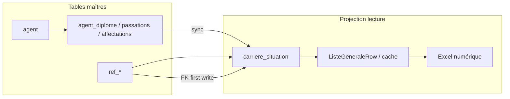

# Checklist de convergence — source de vérité unique (MySQL)

Document opérationnel pour passer du modèle **hybride migration** (libellés + FK, snapshot carrière + dossier) à une **SoT stricte** alignée sur le MCD cible.

**Documents liés :**

- [`MODELE_DONNEES_MYSQL_CIBLE.md`](MODELE_DONNEES_MYSQL_CIBLE.md) — paradigme cible
- [`SCHEMA_MCD_MYSQL_CIBLE.md`](SCHEMA_MCD_MYSQL_CIBLE.md) — MCD / UML
- [`CENTRALISATION_MYSQL.md`](CENTRALISATION_MYSQL.md) — état centralisation actuel
- Schéma déployé : `data/schema/mysql_smegend_unified.sql`

---

## 1. État des lieux (résumé)

| Domaine | SoT actuelle | Écart principal |
|---------|--------------|-----------------|
| Personnel (liste générale) | MySQL `agent` + `carriere_situation` | OK en exploitation |
| Référentiels | MySQL `ref_*` | Fallback `DISTINCT` depuis la liste |
| Diplôme / grade affichés | `carriere_situation` **et** `agent_diplome` / `agent_passation_grade` | Double écriture + sync |
| FK carrière | `*_id` + `*_libelle` en parallèle | Divergence possible |
| Temporalité | `date_debut` / `date_fin` + `sme_periode_id` | `est_actuelle` conservé comme raccourci mois actif |
| Config métier | MySQL `app_config` | Fallback fichiers JSON locaux |
| Access | Import uniquement | OK |

---

## 2. Matrice de priorisation (risque métier)

### P0 — Critique (incohérences visibles utilisateur)

| # | Chantier | Risque si non traité | Fichiers clés | Critère « done » |
|---|----------|----------------------|---------------|------------------|
| P0.1 | **Règle maîtresse diplôme / grade** | Liste générale ≠ dossier agent | `agent_dossier_service.py`, `agent_dossier_sync.py`, `mysql_agent_dossier_repository.py` (`sync_carriere_*`), `mysql_agent_repository.py` | ✅ Dossier maître + projection auto après saisie liste ; bouton « Projeter dossier → liste » |
| P0.2 | **Sync passation après suppression** | Grade liste obsolète après delete passation | `agent_dossier_service.py` (`delete_passation` ne resync pas la fiche) | ✅ `delete_passation` appelle `sync_carriere_grade_from_passations` + invalidation cache |
| P0.3 | **Réconciliation FK post-import** | Exports / filtres structure incohérents | `carriere_reconciliation.py`, `mysql_ref_backfill.py`, `mysql_ref_etl.py` | ✅ Automatique après bundle + rapport import + journal ETL (5 types FK) + invalidation cache |
| P0.4 | **Alignement mois consulté / export** | Archive affichée ≠ Excel généré | `liste_generale_scope.py`, `numerique_excel_export.py`, `numerique_preview_service.py` | ✅ Tests auto `test_archive_export_scope.py` — même `resolve_export_mois` UI/cache/export |

### P1 — Élevé (dette structurelle, erreurs silencieuses)

| # | Chantier | Risque | Fichiers clés | Critère « done » |
|---|----------|--------|---------------|------------------|
| P1.1 | **Référentiels sans fallback DISTINCT** | Nouvelles valeurs « fantômes » hors `ref_*` | `referentiel_service.py`, `mysql_bundle_repositories.py` | ✅ padmin/subdiv/fonctions : ref_* si MySQL (`test_referentiel_strict.py`) |
| P1.2 | **Écriture FK-first** | Libellé et id divergent | `mysql_agent_repository.py`, `prepare_carriere_write_fields` | ✅ FK + libellés ref en une seule écriture (`auto_create` saisie manuelle) |
| P1.3 | **Lecture FK-first** | Affichage legacy incorrect | `_select_liste` dans `mysql_agent_repository.py` | ✅ `IF(fk IS NOT NULL, ref, legacy)` + JOIN padmin/fonction |
| P1.4 | **Fonctions : table maître** | Référentiel fonction = copie des données | `ref_fonction`, `mysql_bundle_repositories.py` | ✅ `fetch_distinct()` = `ref_fonction` seulement |
| P1.5 | **Position admin : table maître** | Périmètre « présent » hétérogène | `ref_position_admin`, `padmin_present.py`, `MySQLPadminRepository` | ✅ `position_admin_choices()` = ref uniquement si MySQL (repli liste si repo indisponible) |

### P2 — Moyen (convergence MCD cible)

| # | Chantier | Objectif | Critère « done » |
|---|----------|----------|------------------|
| P2.1 | **Projection carrière depuis dossier** | Diplôme / grade liste = vue calculée | Vue SQL ou service `build_liste_row_from_dossier(agent_id, periode)` ; `carriere_situation.diplome_*` / `grade_*` marqués dépréciés |
| P2.2 | **Segments temporels** | Historique continu, pas seulement snapshots mensuels | Colonnes `date_debut` / `date_fin` renseignées ; requête « état au mois M » par intervalle (cf. doc cible §4.2) |
| P2.3 | **Matricules sur segment carrière** | Alignement MCD | Migration optionnelle : matricules sur `carriere_situation` ou table dédiée `agent_identifiant` datée |
| P2.4 | **Affectations ↔ structure carrière** | Double source structure/fonction/subdiv | Édition structure liste → met à jour `carriere_situation` ; historique dans `agent_affectation` uniquement |
| P2.5 | **Config MySQL only** | Plus de divergence multi-poste | Supprimer fallbacks fichier dans `layout_config_service.py`, `app_config_store.py` après migration confirmée |

### P3 — Faible (hygiène, documentation)

| # | Chantier | Critère « done » |
|---|----------|------------------|
| P3.1 | Retirer code Access runtime mort (repositories `*_access_*` hors import) | Import bundle seul consomme Access |
| P3.2 | Mettre à jour `PLAN_SME.md` (mentions obsolètes) | Doc alignée MySQL |
| P3.3 | Dashboard « santé données » | Écran ou requête : FK non résolues, agents sans carrière actuelle, doublons legacy |
| P3.4 | Tests de non-régression SoT | Suite dédiée : edit liste → dossier → export numérique même valeur |

---

## 3. Audit du flux critique : édition fiche → dossier → export

### 3.1 Édition depuis la liste générale

```
personnel_edit_dialog
  → PersonnelService.update_personnel()
      → MySQLAgentRepository.update_row()     [écrit carriere_situation + agent]
      → sync_dossier_after_personnel_save()   [agent_diplome / passations / affectations si absent]
      → invalidate_liste_cache()
      → audit_journal
```

**Points de vigilance :**

- La saisie liste écrit d'abord ``carriere_situation`` (identité, padmin, obs).
- Le dossier reçoit une **entrée d'historique** (passation / affectation / diplôme upsert).
- ``sync_carriere_from_dossier`` projette diplôme / grade / structure depuis le dossier (P0.1 ✅).

### 3.2 Édition depuis le dossier agent

```
personnel_dossier_dialog
  → AgentDossierService.add/update/delete_diplome|passation
      → sync_carriere_diplome_from_dossier / sync_carriere_grade_from_passations
      → invalidate_liste_cache()
```

**Points de vigilance :**

- Dossier → carrière : **OK** pour diplôme, grade et affectation (`sync_carriere_from_dossier`).
- `delete_passation` : resync carrière (P0.2 ✅).

### 3.3 Export numérique / liste des présents

```
cached_liste_rows(settings)
  → ListeGeneraleRepository.fetch_all()
  → MySQLAgentRepository (_select_liste + COALESCE ref/libellé)
  → sort_liste_generale_default_order()
  → numerique_excel_export / liste_present_service
```

**Points de vigilance :**

- Cache partagé : **bon** pour cohérence UI/export.
- `COALESCE(référentiel, libellé legacy)` masque les FK manquantes.
- Même mois : `resolve_liste_view_mois` / `build_export_mois_context`.

### 3.3 Schéma du flux cible (SoT stricte)



---

## 4. Plan par phases (suggestion)

### Phase A — Stabilisation (1–2 sprints)

- [x] P0.2 : fix sync `delete_passation`
- [x] P0.1 : documenter règle maître dans `agent_dossier_service.py` (docstring + commentaire architecture)
- [x] P0.3 : réconciliation FK automatique post-import (rapport UI + ETL complet + cache)
- [x] P0.4 : tests auto scope archive / export numérique (`test_archive_export_scope.py`)
- [x] Métrique baseline : `scripts/run_sot_metrics.py` + `collect_sot_metrics`

### Phase B — Référentiels stricts (1 sprint)

- [x] P1.1, P1.4, P1.5 : retrait fallbacks DISTINCT (padmin, subdiv, fonctions, couples structure/subdiv)
- [x] P1.2, P1.3 : écriture/lecture FK-first dans `MySQLAgentRepository` + `prepare_carriere_write_fields`
- [x] Import : projection dossier post-bundle (`project_carriere_from_dossier_batch`)

### Phase C — Dossier maître (2 sprints)

- [x] P2.1 : projection diplôme/grade/affectation depuis dossier (`sync_carriere_from_dossier`, `_project_carriere`)
- [x] P2.4 : sync affectations ↔ carrière (dernière affectation → `carriere_situation`)
- [x] Tests `test_agent_dossier_projection`, `test_agent_dossier_passation_sync`, `test_agent_dossier_manual_sync`

### Phase D — Temporalité MCD (long terme)

- [x] P2.2 : segments `date_debut` / `date_fin` (`segment_dates_for_sme_mois`, `refresh_carriere_segment_dates`)
- [x] Migration requêtes archive : `carriere_scope_sql` par intervalles (+ repli `sme_periode_id` legacy)
- [x] Alignement doc `SCHEMA_MCD_MYSQL_CIBLE.md` (`agent` = `personne` opérationnelle)

---

## 5. Métriques de contrôle (à exécuter en SQL)

Scripts CLI (MySQL configuré via `paths.json`) :

```bash
python scripts/run_sot_metrics.py
python scripts/run_sot_resync.py          # FK + projection dossier + métriques
python scripts/run_sot_resync.py --fk-only --mois 2025-02   # archive
```

### FK carrière non résolues (par mois)

```sql
SELECT
  p.annee_mois,
  SUM(c.grade_id IS NULL AND TRIM(COALESCE(c.grade_libelle,'')) <> '') AS grade_unresolved,
  SUM(c.structure_id IS NULL AND TRIM(COALESCE(c.structure_code,'')) <> '') AS structure_unresolved,
  SUM(c.position_admin_id IS NULL AND TRIM(COALESCE(c.position_admin_libelle,'')) <> '') AS padmin_unresolved,
  SUM(c.fonction_id IS NULL AND TRIM(COALESCE(c.fonction_libelle,'')) <> '') AS fonction_unresolved,
  SUM(c.subdivision_arme_id IS NULL AND TRIM(COALESCE(c.subdivision_arme_libelle,'')) <> '') AS subdiv_unresolved
FROM carriere_situation c
LEFT JOIN sme_periode p ON p.id = c.sme_periode_id
GROUP BY p.annee_mois
ORDER BY p.annee_mois DESC;
```

**Objectif Phase A :** 0 unresolved sur le mois actif.

### Agents sans situation actuelle

```sql
SELECT COUNT(*) FROM agent a
WHERE NOT EXISTS (
  SELECT 1 FROM carriere_situation c
  WHERE c.agent_id = a.id AND c.est_actuelle = 1
);
```

**Objectif :** 0 (hors agents créés en cours de saisie).

### Cohérence diplôme liste vs dossier (échantillon)

La requête de contrôle **doit reproduire la règle de projection**
(`sync_carriere_diplome_from_dossier` : le diplôme **militaire** prime, puis le plus
récent) et normaliser les espaces. Sans cela elle remonte des écarts que l'application
ne corrigera jamais — faux positifs « diplôme militaire vs civil ».

```sql
SELECT c.id, c.diplome_libelle, d.libelle_libre
FROM carriere_situation c
JOIN agent a ON a.id = c.agent_id
LEFT JOIN (
  SELECT agent_id, libelle_libre,
         ROW_NUMBER() OVER (
           PARTITION BY agent_id
           ORDER BY (categorie = 'MILITAIRE') DESC, date_obtention DESC, id DESC
         ) rn
  FROM agent_diplome
) d ON d.agent_id = a.id AND d.rn = 1
WHERE c.est_actuelle = 1
  AND TRIM(REGEXP_REPLACE(REPLACE(COALESCE(c.diplome_libelle, ''),
        CHAR(0xA0 USING utf8mb4), ' '), '[[:space:]]+', ' '))
   <> TRIM(REGEXP_REPLACE(REPLACE(COALESCE(d.libelle_libre, ''),
        CHAR(0xA0 USING utf8mb4), ' '), '[[:space:]]+', ' '))
LIMIT 50;
```

**Objectif :** 0 ligne. La règle appliquée par l'application vit ailleurs et est seule
faisant foi : `services/edition_sme_support.py` → `fetch_dossier_gap_carriere_ids`
(`DOSSIER_DIPLOME_RANK_SQL`, `DOSSIER_PASSATION_RANK_SQL`, `normalize_label_sql`).
Tout changement de règle doit être reporté ici.

---

## 6. Règle maîtresse proposée (à valider métier)

| Donnée | Maître | Projection / affichage |
|--------|--------|------------------------|
| Identité (noms, naissance, matricules) | `agent` | — |
| Situation admin du mois (structure, padmin, fonction, subdiv, obs, ordre) | `carriere_situation` (mois actif) | Liste générale, présents, numérique |
| Diplômes (historique complet) | `agent_diplome` | `carriere_situation.diplome_*` = dernier diplôme militaire (ou dernier tout court) |
| Grades (historique) | `agent_passation_grade` | `carriere_situation.grade_*` = dernière passation |
| Affectations (historique) | `agent_affectation` | `carriere_situation.structure_*` = affectation du mois ou dernière |
| Codes structure / grade / padmin | `ref_*` | FK obligatoire ; libellés dérivés |
| Missions, malades, désertions | `agent_*` + `sme_periode_id` | Satellites numérique |
| Config layout / workspace | `app_config` | — |

**Principe :** une seule direction d'écriture par domaine ; les autres tables sont synchronisées ou calculées à la lecture.

---

## 7. Tests recommandés (pytest)

| Test | Fichier existant / à créer | Vérifie |
|------|----------------------------|---------|
| Edit liste → dossier créé | `test_agent_dossier_manual_sync.py` | P0.1 |
| Delete passation → carrière | `test_agent_dossier_passation_sync.py` | P0.2 ✅ |
| Réconciliation FK | `test_carriere_reconciliation.py` | P0.3 |
| Export mois archive | `test_archive_export_scope.py` | P0.4 ✅ |
| Référentiels stricts | `test_referentiel_strict.py` | P1.1 / P1.4 / P1.5 ✅ |
| FK-first write/read | `test_agent_repository_fk_first.py` | P1.2 / P1.3 ✅ |
| Cache invalidé après write | `test_phase_e_performance.py` | cohérence |
| Scope mois | `test_liste_generale_scope.py` | P0.4 |

---

## 8. Suivi

Cocher les items au fur et à mesure. Lorsqu'une phase est terminée, mettre à jour [`CENTRALISATION_MYSQL.md`](CENTRALISATION_MYSQL.md) et la date ci-dessous.

| Phase | Statut | Date |
|-------|--------|------|
| A — Stabilisation | ☑ | 2026-05 |
| B — Référentiels stricts | ☑ | 2026-05 |
| C — Dossier maître | ☑ | 2026-05 |
| D — Temporalité MCD | ☑ | 2026-05 |
