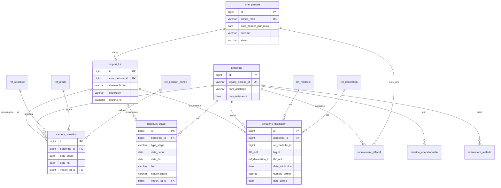

# Modèle de données — inventaire SME-Gend (code actuel) et proposition cible MySQL

Ce document est dérivé du code Python (`sme_gend`) tel qu’il existe dans le dépôt : tables Access, schéma SQLite de référence (`data/schema/liste_generale_sqlite.sql`), import bundle, et modèles applicatifs. Il sert de base à une **migration vers MySQL**. La **section 4** décrit un **nouveau paradigme** (temps au centre, dossier personnel enrichi) : ce n’est **pas** une simple republication des mêmes tables.

---

## 1. Vue d’ensemble du système actuel

| Couche | Rôle |
|--------|------|
| **Microsoft Access** (`.mdb` / `.accdb`) | Source « exploitation » historique : `ListeGenerale`, référentiels, `TabSme`, satellites situation numérique, `TabGainPerte`. |
| **SQLite** (fichier unique) | Mode « liste + bundle » : même sémantique qu’Access après import ; PK interne + `id_acces` ; table `tab_padmin` absente côté Access natif. |
| **Archives mensuelles** | Copies SQLite/Access sous `sme_archives/` ; l’application rebascule la lecture `ListeGenerale` (et référentiels associés) selon le mois fermé. |
| **Fichiers hors SGBD** | Contexte SME (`sme_context.json`), chemins (`paths.json`), mise en page liste des présents (`liste_present_layout.json`), configs détachés / limite d’âge / soit transmis (JSON), journaux d’audit (`.jsonl`). |

**Constat** : le métier est centré sur une table **large** type « fiche personnel » (`ListeGenerale` / `liste_generale`) avec des **clés textuelles** (structure, grade, subdivision, padmin) plutôt que des FK numériques — typique d’une base évolutive, peu normalisée, et **peu favorable aux requêtes historiques** (« état au mois M », progression des carrières).

---

## 2. Inventaire des tables physiques (telles que le code les utilise)

### 2.1 Access — noms et colonnes principales

| Table Access | Usage dans l’app | Colonnes (ordre / sémantique) |
|--------------|------------------|-------------------------------|
| **ListeGenerale** | Personnel, situation admin, rattachement structure/subdivision | `Id`, `noms`, `DateN`, `LieuN`, `Grade`, `DateGrade`, `DateService`, `Ndecision`, `Matmilitaire`, `Matsolde`, `Padmin`, `Fonction`, `SubArme`, `Diplome`, `DateObtention`, `Structure`, `Obs`, `OderTri`, `presseance` (cf. `liste_generale_access_repository.py`, `models/liste_generale.py`). |
| **TabStructure** | Référentiel structures | `code`, `designation`, `OderTri`. |
| **TabGrade** | Référentiel grades | `CodeG`, `Grade`, `PrefOrd`, `EffectifG`. |
| **TabSecun** | Subdivision niveau U | `CodeU`, `SecuDesign`. |
| **TabSecdeux** | Niveau D | `CodeU`, `CodeD`, `SecdDesign`, `PriOutD`. |
| **TabSectrois** | Niveau T | `CodeD`, `CodeT`, `SectDesign`, `PriOutT`. |
| **TabSme** | Périodes SME (mois, statut) | `Codsme`, `mois`, `Statut`. |
| **TabMission** | Satellite mission | `ID`, `Nature`, `LieuMission`, `Refnds`, `DateDepart`. |
| **TabMalade** | Satellite malade | `ID`, `DateConstat`, `Pathologie`, `Obs`. |
| **TabDeserteur** | Satellite déserteur | `ID`, `DatDesertion`. |
| **TabStageLocal** | Stage local | `ID`, `Naturestage`, `LieuStage`, `DateDebutFin`. |
| **TabStageEx** | Stage extérieur | Idem. |
| **TabGainPerte** | Gains / pertes / décès par mois | `ID`, `Grade`, `nom`, `Objet`, `Cdsme`, `Observ`. Clé logique souvent `(ID, Cdsme)` pour CRUD. |

**Pas de table « Fonctions »** : les fonctions sont des **`DISTINCT Fonction` sur ListeGenerale** (`fonctions_access_repository.py`).

### 2.2 SQLite — schéma canonique

Fichier : `data/schema/liste_generale_sqlite.sql`.

| Table SQLite | PK / remarques |
|--------------|----------------|
| `liste_generale` | `id` INTEGER PK AUTOINCREMENT ; `id_acces` UNIQUE (nullable) ; dates souvent TEXT ; `created_at` / `updated_at`. |
| `tab_structure` | `code` TEXT PK. |
| `tab_grade` | `code_g` TEXT PK. |
| `tab_secun` | `code_u` TEXT PK. |
| `tab_secdeux` | `PRIMARY KEY (code_u, code_d)`. |
| `tab_sectrois` | `PRIMARY KEY (code_d, code_t)`. |
| `tab_sme` | `codsme` TEXT PK. |
| `tab_mission`, `tab_malade`, `tab_deserteur`, `tab_stage_local`, `tab_stage_ex` | `id` TEXT PK (jointure = **Id Access personnel** / même clé que satellites). |
| `tab_gain_perte` | `rowid` surrogate + colonnes métier ; index sur `cdsme`, `id`. |
| `tab_padmin` | `libelle` PK ; `compte_comme_present`, `ordre_tri` — **synchronise le périmètre « présent »** avec la liste (JOIN optionnel dans `SqliteListeGeneraleRepository.fetch_presents`). |

### 2.3 Règles de jointure actuelles (à préserver fonctionnellement)

- **Satellites** (`tab_mission`, `tab_malade`, …) : `id` = identifiant **ListeGenerale.Id** (Access). En SQLite, la jointure applicative utilise `id_acces` ou `liste_generale.id` selon le contexte (`ListeGeneraleRow.satellite_join_key()`).
- **Subdivisions** : hiérarchie plate issue du JOIN U–D–T (`subdivision_*_repository.py`).
- **Gains & pertes** : filtre mois via `Cdsme` = `MMYYYY` dérivé du `mois_actif` `YYYY-MM` (`gain_perte_repository.py`).
- **Présents** : filtrage par libellé `Padmin` (heuristique ou table `tab_padmin` en SQLite) — `padmin_present.py`.

---

## 3. Données portées hors base dans l’application

À décider pour MySQL : **restent en fichiers / config**, **volent en JSON MySQL**, ou deviennent **tables**.

| Élément | Fichier / lieu | Contenu |
|---------|----------------|--------|
| Mois actif, mois fermés, thème, colonnes liste, mode présences | `sme_context.json` | Préférences + pilotage SME |
| Chemins BDD / gabarits | `paths.json` | Configuration environnement |
| Sections / ordre liste des présents | `liste_present_layout.json` | Config métier présentation |
| Config Excel détachés | `detaches_config.json` | Sigles ↔ titres |
| Limites d’âge, soit transmis | JSON dans `data/` | Documents paramétrés |
| Audit personnel / imports | `personnel_audit*.jsonl` | Traçabilité hors schéma Access |

---

## 4. Modèle cible MySQL — **changement de paradigme**

**Schéma graphique complet (MCD Mermaid + diagramme de classes UML)** : voir [`SCHEMA_MCD_MYSQL_CIBLE.md`](SCHEMA_MCD_MYSQL_CIBLE.md).

Les sections 2–3 décrivent **l’existant**. Ici, le modèle **ne vise pas** à recréer 1:1 `ListeGenerale` + les mêmes satellites disjoints : il vise un **système historique cohérent** où **les dates et les périodes SME structurent les données**, et où le **dossier personnel** inclut carrière, **stages unifiés**, **médailles** et **décorations**.

### 4.1 Axes de conception

| Axe | Règle |
|-----|--------|
| **Temps au centre** | Toute situation de carrière, tout stage, toute distinction, tout événement RH identifiable porte des **dates effectives** (`DATE` ou `DATETIME` MySQL). Les champs « période » texte (`Cdsme`, chaînes Excel) deviennent **dérivés** ou **redondance contrôlée** pour compatibilité, pas la seule vérité. |
| **Intervalles temporels** | La carrière administrative est modélisée en **segments** : `date_debut` obligatoire, `date_fin` nullable (= en cours). Convention recommandée : semi-intervalle **`[debut, fin)`** ou `fin` = dernier jour inclus — **une seule convention** documentée pour toute l’équipe. |
| **Dimension SME** | Table `sme_periode` avec `annee_mois` (`YYYY-MM`), **`date_dernier_jour_mois` (DATE)** calculé, `codsme` legacy, `statut`. Permet jointures et agrégations **sans parser** `MMYYYY` à chaque requête. |
| **Provenance des archives** | Table `import_lot` : fichier archive, `sme_periode_id`, checksum, horodatage. Chaque fait issu d’un bundle mensuel peut porter `import_lot_id` pour **reconstruire l’historique** et auditer les écarts entre mois. |
| **Dossier personnel complet** | `personne` = identité stable ; le reste = **collections datées** : carrière, parcours de stages, médailles, décorations, missions, indisponibilités, mouvements effectifs. |
| **Référentiels distinctifs** | Médailles et décorations : **`ref_medaille`** / **`ref_decoration`** (code officiel, libellés, ordre de préséance) ; les attributions ne dupliquent pas la définition. |

### 4.2 Cœur : identité et carrière en segments

**`personne`**

- `id` (PK), `legacy_access_id` (UK, ex-`ListeGenerale.Id`),
- identité minimale : noms d’usage, `date_naissance`, `lieu_naissance`, etc.
- **Pas** de grade, structure ou Padmin sur cette table : la **vérité dépend du temps**.

**`carriere_situation`** (nom indicatif)

- `personne_id`, `date_debut`, `date_fin` (NULL si ouvert),
- FK / codes : structure, **subdivision d’arme** (`subdivision_arme_id` → **`ref_subdivision_arme`**, qui pointe vers une **feuille** de **`ref_subdivision_noeud`** + `structure_id` — une subdivision listée appartient à **une** structure ; l’arbre U→D→T est dans **`ref_subdivision_noeud`**), grade, position administrative, fonction (référentiel ou texte transitoire),
- `subdivision_libelle_legacy` : texte brut `SubArme` si la résolution U–D–T échoue,
- `matricule_militaire`, `matricule_solde`, `ndecision`, `ordre_tri`, `presseance`,
- **`diplome_libelle`** / **`date_diplome_obtenu`** : copie **snapshot** de l’ancienne fiche (liste au mois) ; le dossier **normalisé** des diplômes est dans **`personne_diplome`** (plusieurs lignes possibles par personne, voir ci-dessous),
- **`import_lot_id`** (nullable), **`sme_periode_reference_id`** (nullable) : mois / lot sources pour ce segment.

**`ref_diplome`** — référentiel optionnel (code officiel, libellés, niveau, catégorie).

**`personne_diplome`**

- `personne_id`, `ref_diplome_id` (nullable si seul un libellé libre est connu),
- `libelle_libre` (ex. texte issu de `ListeGenerale.Diplome` non rattaché au référentiel),
- `date_obtention`, `lieu_obtention`, `mention`, `numero_dossier`, `etablissement`, `obs`,
- `import_lot_id` pour tracer l’archive / import.
- **Cardinalité** : une personne a **0 à N** diplômes ; chaque diplôme appartient à **une** personne.

**Requête « état au mois M »** (exemple avec fin inclusive dernier jour du mois) :

```sql
-- Paramètre : @d = dernier jour du mois M (DATE)
SELECT ...
FROM carriere_situation cs
WHERE cs.personne_id = ?
  AND cs.date_debut <= @d
  AND (cs.date_fin IS NULL OR cs.date_fin >= @d);
```

Les écrans actuels « une ligne = fiche » deviennent des **vues** ou requêtes **paramétrées par date ou par `sme_periode`**.

### 4.3 Stages : **un modèle unifié** (remplace la logique deux tables parallèles)

Au lieu de `TabStageLocal` et `TabStageEx` sans relation conceptuelle commune, cible :

**`parcours_stage`**

| Colonne | Rôle |
|---------|------|
| `id` | PK |
| `personne_id` | FK |
| `type_stage` | ENUM / FK : `LOCAL`, `EXTERIEUR`, etc. |
| `date_debut`, `date_fin` | DATE (parser `DateDebutFin` legacy ; règles ETL documentées) |
| `lieu`, `nature_libelle` | ex- `LieuStage`, `Naturestage` |
| `reference_dossier` | ex- champs type ordre / réf. |
| `source_ligne_legacy` | ex. `STAGE_LOCAL`, `STAGE_EXTERIEUR` pour traçabilité |
| `import_lot_id` | lot archive |

**ETL depuis les archives** : chaque ligne `tab_stage_local` / `tab_stage_ex` d’un bundle → une ligne `parcours_stage` ; les mois successifs permettent de **contrôler la cohérence** (durées, chevauchements).

**Missions** (`TabMission`) : soit table **`mission_operationnelle`** séparée, soit type `MISSION` dans `parcours_stage` — choix métier (opérationnel vs formation).

### 4.4 Médailles et décorations (hors modèle actuel Access/SQLite app)

Le code applicatif actuel **ne** persiste **pas** médailles/décorations dans ces bases : la cible MySQL les **introduit** pour un dossier complet. Les **archives SME actuelles** ne les contiennent en général **pas** : remplissage par **vagues** :

1. Schéma + référentiels (peuvent démarrer vides ou avec données ministérielles importées une fois),
2. Import fichiers RH (CSV/Excel) si existants,
3. Saisie métier,
4. Éventuellement numérisation / OCR plus tard.

**`ref_medaille`** : `code`, `libelle_court`, `libelle_long`, `categorie`, `ordre_preseance`, `actif`.

**`ref_decoration`** : idem (légion, ordre national, distinctions, etc.).

**`personne_distinction`** — deux FK optionnelles contrôlées en application (`medaille_id` XOR `decoration_id`) **ou** deux tables `personne_medaille` / `personne_decoration` si vous préférez des contraintes SQL strictes.

Champs typiques d’attribution :

- `personne_id`,
- `date_attribution` (**DATE**, cœur du sujet « quand »),
- `date_publication_journal` (nullable),
- `numero_arrete`, `date_arrete`,
- `citation` / `mentions` (TEXT),
- `import_lot_id` ou `source` ENUM (`ARCHIVE_SME`, `IMPORT_RH`, `SAISIE`, …).

### 4.5 Autres faits datés (alignés sur l’existant + types SQL)

- **Malade / déserteur** : `evenement_malade`, `evenement_deserteur` avec `date_constat` / `dat_desertion` en **DATE**, `personne_id`, `import_lot_id`.
- **Mouvements effectifs** : `mouvement_effectif` avec FK **`sme_periode_id`**, `date_reference` (ex. fin de mois), type GAIN/PERTE, `observ` (ex. DÉCÈS) ; garder `cdsme` en colonne dérivée si besoin.
- **Mission** : champs typés + `date_depart` DATE.

### 4.6 Schéma relationnel cible (Mermaid — logique révisée)



### 4.7 Alimentation depuis les **archives actuelles**

1. Créer les lignes **`sme_periode`** pour chaque mois connu (`TabSme` + règles métier).
2. Pour chaque fichier sous `sme_archives/` : **`import_lot`** + `sme_periode_id`.
3. **`personne`** : une ligne par `legacy_access_id` (résolution des doublons hors périmètre avant UK).
4. **`carriere_situation`** : pour chaque snapshot `liste_generale` d’une archive, produire des segments datés. **Décision projet** : soit une ligne par mois (simple mais verbeux), soit **fusion** des segments identiques sur des mois consécutifs (moins de lignes, même sémantique).
5. **`parcours_stage`** : union des stages de tous les bundles, avec `import_lot_id` ; détection d’écarts entre mois.
6. **Gain/perte** : rattachés à `sme_periode` + dates typées.
7. **Médailles / décorations** : prêtes en schéma ; données **hors archives SME actuelles** jusqu’à import métier.
8. **Contrôles** : effectifs présents, NUMERIQUE, détachés — comparaison chiffrée **mois par mois** avec l’application actuelle sur un jeu témoin.

### 4.8 Correspondance « ancien monde » → nouveau (résumé)

| Existant | Cible |
|----------|--------|
| `ListeGenerale` (fiche unique) | `personne` + **`carriere_situation`** (segments) + vues « fiche au mois M » ; **`Diplome` / `DateObtention`** → **`personne_diplome`** (N par personne) + champs snapshot sur `carriere_situation`. |
| `TabStageLocal` / `TabStageEx` | **`parcours_stage`** + `type_stage` + dates normalisées. |
| `TabMission`, `TabMalade`, `TabDeserteur` | Tables d’**événements** avec types date SQL + `personne_id`. |
| `TabGainPerte` | `mouvement_effectif` lié **`sme_periode`** + `date_reference`. |
| *(absent aujourd’hui)* | **`ref_medaille`**, **`ref_decoration`**, **`personne_distinction`**. |
| `TabSecun` / `TabSecdeux` / `TabSectrois` | Import en arbre : **`ref_subdivision_noeud`** + affiliations **`ref_subdivision_arme`** (`structure_id`, `noeud_feuille_id`) ; carrière via `subdivision_arme_id`. |
| `tab_padmin` | `ref_position_admin` (même esprit). |

---

## 5. Index et optimisation MySQL (cohérence temporelle)

- **`carriere_situation`** : `(personne_id, date_debut)`, `(personne_id, date_fin)` ; requêtes « au mois M » via date de référence indexée.
- **`parcours_stage`** : `(personne_id, date_debut)`, `(type_stage, date_debut)` pour bilans.
- **`personne_distinction`** : `(personne_id, date_attribution)` ; `(ref_medaille_id)`, `(ref_decoration_id)`.
- **`mouvement_effectif`** : `(sme_periode_id)`, `(personne_id, sme_periode_id)`.
- **`import_lot`** : `(sme_periode_id)`.
- **InnoDB**, **utf8mb4** ; migrer les anciens champs TEXT « date » vers **DATE** après ETL.

---

## 6. Points d’attention migration

1. **Parser et valider toutes les dates** en ETL ; isoler les lignes en échec (`etl_erreur` ou équivalent).
2. **`DateDebutFin` des stages** : règles explicites (intervalle, « du… au… », une seule date).
3. **Bitemporité** (avancé) : si la DRH distingue « date de fait » / « date de saisie », ajouter des colonnes de versioning ; sinon le couple `date_debut` / `date_fin` suffit en phase 1.
4. **Référentiels médailles/décorations** : caler sur nomenclature officielle avant imports de masse.

---

## 7. Fichiers de code de référence (traceabilité)

- Schéma SQLite : `data/schema/liste_generale_sqlite.sql`
- Liste générale Access : `repositories/liste_generale_access_repository.py`
- Liste générale SQLite : `repositories/liste_generale_sqlite_repository.py`
- Import bundle : `services/sqlite_bundle_import.py`
- SME : `repositories/sme_*_repository.py`, `models/sme_row.py`
- Gains/pertes : `repositories/gain_perte_*_repository.py`, `models/gain_perte.py`
- Satellites : `repositories/numerique_satellite_*_repository.py`
- Subdivisions : `repositories/subdivision_*_repository.py`
- Contexte / hors DB : `config/sme_context.py`, `config/settings.py`, `services/layout_config_service.py`

---

## 8. Prochaines étapes suggérées

1. **Trancher** la règle de **fusion des segments** `carriere_situation` entre mois identiques.
2. Décider : **missions** = table dédiée ou type dans `parcours_stage`.
3. Constituer **`ref_medaille` / `ref_decoration`** (source officielle).
4. Rédiger le **DDL MySQL** + premier **ETL** : un lot d’archives → `import_lot` + tables temporelles + rapports de contrôle.
5. Phase **lecture seule** : comparer indicateurs MySQL vs application actuelle.

---

*Sections 1–3 : inventaire de l’existant. Section 4 : modèle **intentionnel** centré sur le temps et le dossier enrichi (stages, médailles, décorations), alimenté d’abord par les archives SME actuelles puis par imports métier.*
