# MCD & diagramme de classes — système cible MySQL (SME-Gend)

Document compagnon de [`MODELE_DONNEES_MYSQL_CIBLE.md`](MODELE_DONNEES_MYSQL_CIBLE.md).  
Vue **MERISE (MCD)** via diagramme entité-association Mermaid, puis vue **UML (classes)**.

> **Nommage opérationnel :** le schéma MySQL déployé utilise la table **`agent`** (et non `personne`) pour l’identité stable ; les entités **`personne_*`** / **`personne_diplome`** du MCD cible correspondent respectivement à **`agent`** / **`agent_diplome`**. Les règles temporelles (`date_debut`, `date_fin` inclusives) s’appliquent à **`carriere_situation`** dans les deux vocabulaires.

**Légende des cardinalités (lecture MERISE)** : sur une association *Personne* — *Carrière*, « 1,N » côté personne signifie qu’une personne a **un à plusieurs** segments ; « 0,N » côté grade signifie qu’un grade est porté par **zéro à plusieurs** segments (plusieurs personnes, plusieurs périodes).

---

## 1. MCD complet (Mermaid `erDiagram`)

À copier dans tout éditeur compatible Mermaid (GitHub, VS Code, Obsidian, etc.).

```mermaid
erDiagram
  %% ========== Temps & provenance ==========
  sme_periode ||--o{ import_lot : "1..1 / 0..*"
  sme_periode ||--o{ mouvement_effectif : "1..1 / 0..*"

  %% ========== Personne & carrière (segments datés) ==========
  personne ||--o{ carriere_situation : "1 / 1..* segment"
  ref_structure ||--o{ carriere_situation : "1 / 0..*"
  ref_structure ||--o{ ref_subdivision_arme : "1 / 0..*"
  ref_grade ||--o{ carriere_situation : "1 / 0..*"
  ref_position_admin ||--o{ carriere_situation : "1 / 0..*"
  ref_subdivision_arme ||--o{ carriere_situation : "0..1 / 0..*"
  ref_fonction ||--o{ carriere_situation : "0..1 / 0..*"

  import_lot ||--o{ carriere_situation : "0..1 / 0..*"

  %% ========== Parcours & missions ==========
  ref_type_stage ||--o{ parcours_stage : "1 / 0..*"
  personne ||--o{ parcours_stage : "1 / 0..*"
  import_lot ||--o{ parcours_stage : "0..1 / 0..*"

  personne ||--o{ mission_operationnelle : "1 / 0..*"
  import_lot ||--o{ mission_operationnelle : "0..1 / 0..*"

  %% ========== Événements (indispo / statut) ==========
  personne ||--o{ evenement_malade : "1 / 0..*"
  personne ||--o{ evenement_deserteur : "1 / 0..*"
  import_lot ||--o{ evenement_malade : "0..1 / 0..*"
  import_lot ||--o{ evenement_deserteur : "0..1 / 0..*"

  %% ========== Distinctions ==========
  personne ||--o{ personne_distinction : "1 / 0..*"
  ref_medaille ||--o{ personne_distinction : "0..1 / 0..*"
  ref_decoration ||--o{ personne_distinction : "0..1 / 0..*"
  import_lot ||--o{ personne_distinction : "0..1 / 0..*"

  %% ========== Diplômes (1..N par personne) ==========
  personne ||--o{ personne_diplome : "1 / 0..*"
  ref_diplome ||--o{ personne_diplome : "0..1 / 0..*"
  import_lot ||--o{ personne_diplome : "0..1 / 0..*"

  %% ========== Mouvements effectifs (gains-pertes) ==========
  personne ||--o{ mouvement_effectif : "1 / 0..*"
  import_lot ||--o{ mouvement_effectif : "0..1 / 0..*"

  %% ========== Hiérarchie subdivision d'arme (liste d'adjacence ; ex-TabSec* importées en arbre) ==========
  ref_subdivision_noeud ||--o{ ref_subdivision_noeud : "parent / enfant"
  ref_subdivision_noeud ||--o{ ref_subdivision_arme : "feuille / affiliation structure"

  %% --- Entités & attributs principaux ---
  personne {
    bigint id PK
    varchar legacy_access_id UK
    varchar nom_affichage
    varchar prenoms
    date date_naissance
    varchar lieu_naissance
    datetime cree_le
  }

  sme_periode {
    bigint id PK
    varchar annee_mois UK
    date date_dernier_jour_mois
    varchar codsme
    varchar statut
  }

  import_lot {
    bigint id PK
    bigint sme_periode_id FK
    varchar chemin_fichier
    varchar checksum
    datetime importe_le
  }

  carriere_situation {
    bigint id PK
    bigint personne_id FK
    date date_debut
    date date_fin
    bigint structure_id FK
    bigint grade_id FK
    bigint position_admin_id FK
    bigint subdivision_arme_id FK
    varchar subdivision_libelle_legacy
    bigint fonction_id FK
    varchar matricule_militaire
    varchar matricule_solde
    varchar ndecision
    varchar diplome_libelle
    int ordre_tri
    int presseance
    text obs
    bigint import_lot_id FK
    bigint sme_periode_reference_id FK
  }

  ref_structure {
    bigint id PK
    varchar code UK
    varchar designation
    int ordre_tri
  }

  ref_grade {
    bigint id PK
    varchar code UK
    varchar libelle
    int pref_ord
    int effectif_g
  }

  ref_position_admin {
    bigint id PK
    varchar libelle UK
    boolean compte_comme_present
    int ordre_tri
  }

  ref_fonction {
    bigint id PK
    varchar libelle UK
  }

  ref_subdivision_noeud {
    bigint id PK
    bigint parent_id FK_null
    varchar code
    varchar libelle
    float pri_out
  }

  ref_subdivision_arme {
    bigint id PK
    bigint structure_id FK
    bigint noeud_feuille_id FK
    varchar libelle
    int ordre_tri
    boolean actif
  }

  ref_type_stage {
    varchar code PK
    varchar libelle
  }

  parcours_stage {
    bigint id PK
    bigint personne_id FK
    varchar type_stage_code FK
    date date_debut
    date date_fin
    varchar lieu
    varchar nature_libelle
    varchar reference_dossier
    varchar source_ligne_legacy
    text observation
    bigint import_lot_id FK
  }

  mission_operationnelle {
    bigint id PK
    bigint personne_id FK
    varchar nature
    varchar lieu_mission
    varchar refnds
    date date_depart
    bigint import_lot_id FK
  }

  evenement_malade {
    bigint id PK
    bigint personne_id FK
    date date_constat
    varchar pathologie
    text obs
    bigint import_lot_id FK
  }

  evenement_deserteur {
    bigint id PK
    bigint personne_id FK
    date date_desertion
    bigint import_lot_id FK
  }

  mouvement_effectif {
    bigint id PK
    bigint sme_periode_id FK
    bigint personne_id FK
    varchar identifiant_ligne
    varchar grade_snapshot
    varchar nom_snapshot
    varchar type_mouvement
    varchar cdsme_derive
    varchar observ
    date date_reference
    bigint import_lot_id FK
  }

  ref_medaille {
    bigint id PK
    varchar code UK
    varchar libelle_court
    varchar libelle_long
    varchar categorie
    int ordre_preseance
    boolean actif
  }

  ref_decoration {
    bigint id PK
    varchar code UK
    varchar libelle_court
    varchar libelle_long
    varchar categorie
    int ordre_preseance
    boolean actif
  }

  ref_diplome {
    bigint id PK
    varchar code UK
    varchar libelle_court
    varchar libelle_long
    varchar categorie
    varchar niveau
    int ordre_tri
    boolean actif
  }

  personne_diplome {
    bigint id PK
    bigint personne_id FK
    bigint ref_diplome_id FK
    varchar libelle_libre
    date date_obtention
    varchar lieu_obtention
    varchar mention
    varchar numero_dossier
    varchar etablissement
    text obs
    bigint import_lot_id FK
  }

  personne_distinction {
    bigint id PK
    bigint personne_id FK
    bigint ref_medaille_id FK
    bigint ref_decoration_id FK
    date date_attribution
    date date_publication_journal
    varchar numero_arrete
    date date_arrete
    text citation
    varchar source
    bigint import_lot_id FK
  }
```

**Note** : la hiérarchie U–D–T héritée des **TabSec\*** est modélisée en **une seule table** `ref_subdivision_noeud` (liste d’adjacence, racine technique id=1). `ref_subdivision_arme` = **affiliation** d’une **feuille** (niveau T) à une **structure** ; clé d’unicité `(structure_id, noeud_feuille_id)`.

**Contrainte métier** : sur `personne_distinction`, une seule des deux FK `ref_medaille_id` ou `ref_decoration_id` doit être non nulle (à garantir par trigger ou par deux tables filles).

**Diplômes** : `personne_diplome` autorise **plusieurs lignes** par personne. Au moins une des trois informations suivantes doit être présente : `ref_diplome_id`, `libelle_libre` (texte issu de l’ancien champ liste), ou `date_obtention`. Les colonnes `diplome_libelle` / `date_diplome_obtenu` sur `carriere_situation` restent un **aperçu** hérité du snapshot mensuel ; la fiche diplômes complète se construit sur `personne_diplome`.

---

## 2. Diagramme de classes UML (Mermaid `classDiagram`)

Vue objet : agrégations/compositions simplifiées ; les **dates** portent sur les classes « fait » ou « segment ».

```mermaid
classDiagram
  direction TB

  class Personne {
    +Long id
    +String legacyAccessId
    +String nomAffichage
    +LocalDate dateNaissance
  }

  class SmePeriode {
    +Long id
    +String anneeMois
    +LocalDate dateDernierJourMois
    +String statut
  }

  class ImportLot {
    +Long id
    +String cheminFichier
    +String checksum
    +OffsetDateTime importeLe
  }

  class CarriereSituation {
    +Long id
    +LocalDate dateDebut
    +LocalDate dateFin
    +String matriculeMilitaire
    +String matriculeSolde
    +Integer ordreTri
    +Integer presseance
  }

  class RefStructure {
    +Long id
    +String code
    +String designation
  }

  class RefGrade {
    +Long id
    +String code
    +String libelle
  }

  class RefPositionAdmin {
    +Long id
    +String libelle
    +Boolean compteCommePresent
  }

  class RefFonction {
    +Long id
    +String libelle
  }

  class RefSubdivisionNoeud {
    +Long id
    +Long parentId
    +String code
    +String libelle
  }

  class RefSubdivisionArme {
    +Long id
    +Long structureId
    +Long noeudFeuilleId
    +String libelle
  }

  class ParcoursStage {
    +Long id
    +LocalDate dateDebut
    +LocalDate dateFin
    +String lieu
    +String natureLibelle
  }

  class RefTypeStage {
    +String code
    +String libelle
  }

  class MissionOperationnelle {
    +Long id
    +String nature
    +String lieuMission
    +LocalDate dateDepart
  }

  class EvenementMalade {
    +Long id
    +LocalDate dateConstat
    +String pathologie
  }

  class EvenementDeserteur {
    +Long id
    +LocalDate dateDesertion
  }

  class MouvementEffectif {
    +Long id
    +String typeMouvement
    +LocalDate dateReference
    +String observ
  }

  class RefMedaille {
    +Long id
    +String code
    +String libelleLong
  }

  class RefDecoration {
    +Long id
    +String code
    +String libelleLong
  }

  class PersonneDistinction {
    +Long id
    +LocalDate dateAttribution
    +String numeroArrete
  }

  RefSubdivisionNoeud "0..1" --> "*" RefSubdivisionNoeud : parent
  RefStructure "1" --> "*" RefSubdivisionArme
  RefSubdivisionNoeud "1" --> "*" RefSubdivisionArme : feuille

  Personne "1" --> "*" CarriereSituation : segments temporels
  RefStructure "1" --> "*" CarriereSituation
  RefGrade "1" --> "*" CarriereSituation
  RefPositionAdmin "1" --> "*" CarriereSituation
  RefFonction "0..1" --> "*" CarriereSituation
  RefSubdivisionArme "0..1" --> "*" CarriereSituation

  Personne "1" --> "*" ParcoursStage
  RefTypeStage "1" --> "*" ParcoursStage

  Personne "1" --> "*" MissionOperationnelle
  Personne "1" --> "*" EvenementMalade
  Personne "1" --> "*" EvenementDeserteur
  Personne "1" --> "*" MouvementEffectif
  Personne "1" --> "*" PersonneDistinction

  SmePeriode "1" --> "*" ImportLot
  SmePeriode "1" --> "*" MouvementEffectif

  ImportLot "0..1" --> "*" CarriereSituation
  ImportLot "0..1" --> "*" ParcoursStage
  ImportLot "0..1" --> "*" PersonneDistinction
  ImportLot "0..1" --> "*" EvenementMalade
  ImportLot "0..1" --> "*" EvenementDeserteur
  ImportLot "0..1" --> "*" MissionOperationnelle
  ImportLot "0..1" --> "*" MouvementEffectif

  RefMedaille "0..1" --> "*" PersonneDistinction
  RefDecoration "0..1" --> "*" PersonneDistinction
```



---

## 3. Synthèse des associations clés

| Association | Cardinalité | Interprétation |
|-------------|-------------|----------------|
| Personne — CarriereSituation | 1 : 0..* | Plusieurs segments dans le temps (grade, structure, Padmin, etc.). |
| RefGrade — CarriereSituation | 1 : 0..* | Un même grade est porté par plusieurs personnes / périodes. |
| Personne — ParcoursStage | 1 : 0..* | Stages successifs ou parallèles (selon règles métier). |
| Personne — PersonneDistinction | 1 : 0..* | Plusieurs médailles / décorations dans le temps. |
| SmePeriode — ImportLot | 1 : 0..* | Un mois SME peut avoir plusieurs imports (reprises). |
| SmePeriode — MouvementEffectif | 1 : 0..* | Mouvements de personnel rattachés au mois de référence SME. |

---

*Ce schéma est une vue cible ; les types (`bigint` vs `UUID`) et noms exacts des tables restent à figer dans le DDL MySQL.*
